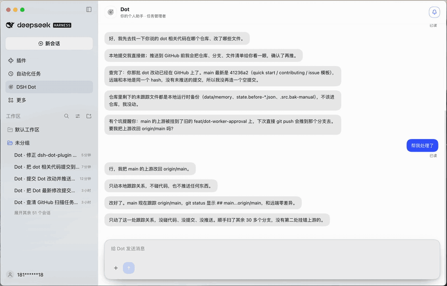

# DSH Dot

[](https://github.com/1315577677/dsh-dot-plugin/actions/workflows/ci.yml)

**English** | [简体中文](README.md)

> Your personal assistant for DeepSeek Harness. You hand Dot an outcome, Dot runs the team, and Dot comes back with the result.

## Quick start

Paste this into **Plugins → install** in DeepSeek Harness Desktop, then restart once:

```
https://github.com/1315577677/dsh-dot-plugin/releases/download/v1.0.0/dsh-dot-plugin-1.0.0.tgz
```

Then open **DSH Dot** in the sidebar and say what you want. [More install options](#install) · [What it does](#what-dot-can-do-for-you) · [How it works](#how-dot-works)

## Before and after

| Before | With Dot |
|---|---|
| Five conversations running, none of them finishing, and you are the only one keeping track. | One chat. Dot owns the plan, the workers, the review, and the report. |
| A worker gets stuck and nothing tells you. | Dot watches every worker and asks you the one question that unblocks it. |
| You copy results between windows by hand. | Verified results and artifacts land in the Dot chat. |




---

## What is DSH Dot?

DeepSeek Harness gives you workspaces, sessions, and as many parallel conversations as you can start. Keeping track of all of them becomes a job in itself.

DSH Dot is the layer above that. It is not another coding session — it is the one place you talk to, and it owns the work:

- you say what you want;
- Dot acknowledges immediately, breaks the request into tasks, and delegates;
- background workers do the research, edits, and commands in real DeepSeek Harness sessions;
- Dot reviews what comes back, pushes back when it is wrong, and tells you when it is done.

You never switch windows to manage the work. You can watch it if you want — every worker is a real session — but you do not have to.

## What Dot can do for you

| | |
|---|---|
| **One front door** | A dedicated Dot chat in the sidebar. No workspace picker, no mode picker, no tool noise. You talk, Dot manages. |
| **Real tasks** | Every request becomes a durable task with a status, plan, evidence, and owner. Tasks survive restarts. |
| **Visible delegation** | Each task runs in its own titled Harness session (`Dot · <task>`). The brief Dot gave that worker is a real user message you can open and read. |
| **Workspace-scoped work** | A task can target any of your Harness workspaces. The worker gets `read`, `glob`, `grep`, `write`, `edit`, `bash`, and web tools **inside that workspace only**. |
| **Append vs depend** | A supplement or correction goes straight into the running task (`dot_append_task`) without waiting. A genuinely new step that needs the first result is created with `depends_on` and starts when the dependency finishes. |
| **Real cancellation** | Stopping a task aborts the worker's active turn and disposes its agent — the token spend actually stops. |
| **Long-term memory** | `dot_remember` / `dot_recall` keep sourced facts (preferences, decisions, project context) across sessions, with file/date/snippet evidence. Nothing invented; secrets refused. |
| **Worker capacity** | 2–8 worker slots, persisted. Dot explains what a queued task is waiting behind and asks before raising the limit. |
| **Chat that reads human** | Short plain-text messages, one thought per message, sequential bubbles, quote replies that jump to the original message. |
| **Manager-reviewed approval** | Worker approval requests go to Dot: clearly safe actions are allowed once, clearly unsafe ones are rejected, and uncertain ones become a card in the Dot chat. Dot proposals still require your approval. |
| **Talk-to-schedule** | Say “every day at 9” or “check this every hour”; Dot creates its own durable schedule, can list/update/cancel it, and turns each firing into a task or a report. |
| **Opt-in proactive scan** | A separate, read-only scanner ranks recent workspace activity first, then deep-scans only the workspace you are actually working in. High-confidence findings are handed to Dot, never auto-fixed. Off by default. |

## How Dot works

Dot is a manager with a loop, not a model that happens to be called from a chat.

```
   you
    │  request
    ▼
 ┌──────────────┐          ┌──────────────────────────────────────────┐
 │  Dot chat    │─────────▶│               DOT (manager)              │
 │  (only UI)   │          │  1 intake    acknowledge in 1–2 lines    │
 └──────────────┘◀─────────│  2 plan      task + next action          │
    ▲  result              │  3 delegate  assign a worker             │
    │                      │  4 review    check evidence, push back   │
    │                      │  5 report    result, or one question     │
    │                      │  6 archive   complete with evidence      │
    │                      └───────┬──────────────────────┬───────────┘
    │                              │ assign               │ approve
    │                              ▼                      ▼
    │                    ┌──────────────────┐   ┌────────────────────┐
    │                    │  Worker agent    │   │  Executor agent    │
    │                    │  own Session     │   │  own Session       │
    │                    │  task workspace  │   │  approved tools    │
    │                    │  r/w/edit/bash   │   │  one approved act  │
    │                    └────────┬─────────┘   └─────────┬──────────┘
    │                             │ result / progress      │ result
    │                             ▼                        ▼
    │                    ┌──────────────────────────────────────┐
    └────────────────────│  events → task state → Dot review    │
                         └──────────────────────────────────────┘
```

The loop, concretely:

1. **Intake.** You send a message. Dot answers first — what it understood and what it will do — before any work starts.
2. **Plan.** The request becomes a task with a title, a request, a plan, and a next action.
3. **Delegate.** `dot_assign_worker` hands the task to the coordinator. If a slot is free the worker starts now; otherwise the task is queued and Dot tells you what it is behind.
4. **Work.** The worker runs in its own Harness session, scoped to the task workspace. It may edit files and run commands there. It reports progress and a final result.
5. **Review.** The worker returning wakes Dot. Dot reads the result, compares it with the request, and either accepts it, sends another instruction to the same worker, or asks you one question.
6. **Report.** A verified result becomes plain messages in the Dot chat. The task closes only with an artifact or a verified summary.

Alongside the loop:

- **Interruptions are expected.** New messages arrive while work is running. Dot classifies each one: append to the running task, dependent new task, or unrelated new task. Nothing is silently dropped and nothing waits that should not.
- **Everything is inspectable.** Task events, artifacts, worker sessions, and memory files are on disk. A Dot run is never a black box.
- **Nothing consequential happens alone.** Approval is user-only. Workers cannot approve their own work, and the executor only does what was approved.
- **Dot never does the work itself.** In manager mode Dot has no `read`, `write`, `bash`, or web tools. If it cannot delegate, it reports the blocker instead of quietly becoming the worker.

## v1.0.0

The first stable release after the 0.x iterations. It adds Dot-owned scheduled tasks, the opt-in proactive workspace scanner, the plugin settings page, and the final chat receipt/quote behavior.

## Install

### Option A — Install from the plugin directory (easiest)

DeepSeek Harness Desktop installs a plugin from a *spec*. Use the package name once it is published to a registry, or a tarball URL / local folder:

```
dsh-dot-plugin
```

```
https://github.com/1315577677/dsh-dot-plugin/releases/download/v1.0.0/dsh-dot-plugin-1.0.0.tgz
```

Steps:

1. Open **DeepSeek Harness Desktop**.
2. Open **插件 / Plugins** in the left sidebar.
3. Paste the spec above into the install field and confirm.
4. Wait until it reports *installed*, then restart the app once.

After restart, **DSH Dot** appears in the sidebar under 自动化任务. Click it: the Dot chat opens.

> A build without a published tarball can be installed by absolute path (`/absolute/path/to/package` or `link:/absolute/path/to/package`).

### Option B — From source (contributors)

```bash
git clone https://github.com/1315577677/dsh-dot-plugin.git
cd dsh-dot-plugin
pnpm install
pnpm build        # tsc for host and client
pnpm test         # node --test
```

Then install the cloned folder with Option A, using its absolute path.

### Option C — Tarball release

Every GitHub release attaches `dsh-dot-plugin-<version>.tgz`, the same artifact `npm pack` produces. It contains the built `lib/`, `cordis.patch.yml`, the client bundle, and the locales, so it installs without a toolchain.

### Requirements

- DeepSeek Harness Desktop `0.2.1-rc.2` or newer
- Node.js 22+ only for a source build
- A workspace to point Dot at; the current workspace is the default

### First run

1. Click **DSH Dot** in the sidebar.
2. Say something concrete: *“Check the failing tests in this workspace and fix them.”*
3. Dot answers in a line or two, creates a task, and assigns a worker.
4. A `Dot · <task>` session appears in the workspace list. Open it if you want to watch.
5. Dot reports back in the chat when the work is verified.

## Configuration

The bundle patch creates one plugin row. Useful fields in `cordis.patch.yml` (or your profile override):

```yaml
- insert:
    - id: dsh-dot-plugin
      name: 'dsh-dot-plugin'
      config:
        enabled: true
        orchestrator: true          # manager mode; false = legacy research mode
        agentPreset: standard
        maxWorkers: 4               # 2–8 worker slots
        workerTimeoutMs: 600000
        executionTools:             # tools the approved executor may use
          - write
          - edit
        systemProactive:            # off by default; read-only background scan
          enabled: false
          intervalMinutes: 240
          activeWindowHours: 48
          minConfidence: 0.8
          maxMessagesPerDay: 1
          quietHours: '22:00-08:00'
```

| Field | Default | Meaning |
|---|---|---|
| `orchestrator` | `true` | Manager/worker mode. `false` restores the legacy read-only research agent. |
| `maxWorkers` | `4` | Initial worker slots (2–8). A user-raised limit is persisted and survives restarts. |
| `agentPreset` | `standard` | Harness preset used by the manager, workers, and the executor. |
| `workerTimeoutMs` | `600000` | Soft timeout for a worker turn. |
| `executionTools` | `write`, `edit` | Tools the executor may use after approval. |
| `autoApproveLowRisk` | `false` | Keep `false`: approval is user-only. |
| `systemProactive.enabled` | `false` | Opt-in read-only background scan of registered workspaces. It can notify Dot but cannot edit files, create tasks, or control Dot's schedules. |
| `systemProactive.intervalMinutes` | `240` | Minimum time between scans. |
| `systemProactive.activeWindowHours` | `48` | Only files modified in this window are inspected. |
| `systemProactive.maxWorkspaces` | `20` | Maximum registered workspaces whose recent metadata is inspected to locate the user's focus. |
| `systemProactive.focusWorkspaces` | `1` | After ranking attention, only this many top workspaces are read in depth and reviewed. |
| `systemProactive.minConfidence` | `0.8` | Findings below this confidence are discarded. |
| `systemProactive.maxMessagesPerDay` | `1` | Hard cap on proactive notifications. |
| `systemProactive.quietHours` | `22:00-08:00` | Local-time window with no proactive notifications. |
| `systemProactive.workspaceAllowlist` | `[]` | Optional absolute paths; empty means all registered workspaces. |
| `systemProactive.workspaceDenylist` | `[]` | Optional paths to exclude. |
| `systemProactive.provider` / `model` | empty | Optional cheap model for scan review; falls back to `reviewModel` or the default model. |

The same settings are editable from the plugin's page in **Plugins → DSH Dot**. The page writes the profile patch through the Host `configEditor` service; it is not a separate configuration file.

State lives next to the plugin data directory: `state.json` (tasks, chat, proposals, triggers), `system-proactive.json` (separate scanner state), `memory/` (facts, profile, journals), `worker-limit.json`.

## Safety model

- The manager cannot read files, run commands, or touch the network. It can only manage tasks and talk to you.
- A worker is confined to **its task's workspace**, for reads, writes, and commands.
- External actions (send, publish, pay, delete, invite, account changes) and cross-workspace work become a proposal.
- Worker approval requests are reviewed by Dot. Safe, task-consistent actions may be allowed once; unsafe actions are rejected; uncertain requests are shown to you in the Dot chat.
- Approving a Dot proposal starts a *separate* executor session with only the approved tools. The manager never executes.
- `dot_remember` refuses secrets and requires a real, verifiable source.

## Development

```bash
pnpm install
pnpm typecheck
pnpm build
pnpm test
```

```
src/host/               Host half: runtime, state, tasks, HTTP routes
src/host/orchestrator/  manager tools, coordinator, worker manager, capacity
src/host/memory/        facts, digests, recall index
src/host/proactive/     opt-in read-only proactive scanner
src/client.ts           Client half: the Dot chat page
test/                   node --test suites
specs/                  design notes
```

Pull requests: keep the delegation boundary and the manager-reviewed/user-approved approval model intact. A change that broadens execution authority needs a threat-model note and a test. See [CONTRIBUTING.md](CONTRIBUTING.md) for the full ground rules, the review checks, and what the project will not accept.

## License

MIT — see [LICENSE](LICENSE).

DSH Dot is inspired by the capability model of personal-assistant agents, but it is an independent open-source project. It is not affiliated with, endorsed by, or connected to OpenAI.
