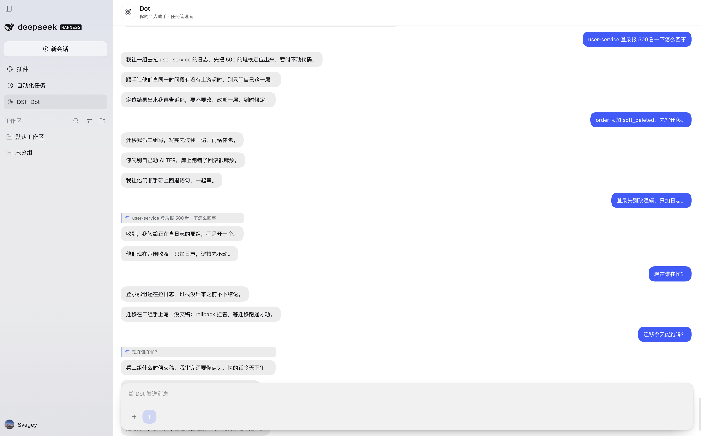

# DSH Dot

[](https://github.com/1315577677/dsh-dot-plugin/actions/workflows/ci.yml)

**中文** · [English](README.md)

> 你的 DeepSeek Harness 个人助手。你把一件事交给 Dot，Dot 来组织执行，最后把结果交回给你。

## 30 秒上手

在 DeepSeek Harness Desktop 里打开 **插件 → 安装**，粘贴下面这一行，然后重启一次：

```
https://github.com/1315577677/dsh-dot-plugin/releases/download/v1.0.0/dsh-dot-plugin-1.0.0.tgz
```

重启后点侧边栏的 **DSH Dot**，直接说要做什么。 [更多安装方式](#安装) · [它能做什么](#dot-能替你做什么) · [它怎么工作](#dot-是怎么工作的)

## 以前和现在

| 以前 | 用 Dot 之后 |
|---|---|
| 五个会话同时跑，谁都没跑完，只有你一直在盯。 | 一个对话。计划、worker、检查、汇报都由 Dot 负责。 |
| worker 卡住了，没人告诉你。 | Dot 盯着每个 worker，只问你那个能解开卡点的问题。 |
| 结果靠你手动在窗口之间复制。 | 验证过的结果和产物直接落在 Dot 对话里。 |



---

## DSH Dot 是什么

DeepSeek Harness 有工作区、会话，可以同时开很多对话。但要一直记住每一个窗口在做什么，本身就是一件全职的事。

DSH Dot 是这一层之上的东西。它不是又一个编程会话，而是你唯一需要开口说话的地方，它替你管事情：

- 你说你想要什么；
- Dot 立刻回应，把需求拆成任务，派出去；
- 后台 worker 在真实的 DeepSeek Harness 会话里做调研、改代码、跑命令；
- Dot 检查回来的结果，不对就打回去重做，确认没问题后再告诉你。

你不需要切换窗口去管进度。你想看可以看——每个 worker 都是真实会话——但你不必看。

## Dot 能替你做什么

| | |
|---|---|
| **一个入口** | 侧边栏里的 Dot 对话。没有工作区选择，没有模式选择，没有工具噪音。你说，它管。 |
| **真实任务** | 每个需求变成一条持久任务：状态、计划、证据、负责人。重启后仍然存在。 |
| **可见的委派** | 每条任务跑在自己的命名会话里（`Dot · <任务名>`）。Dot 给 worker 的 brief 就是一条真实的用户消息，可以打开看。 |
| **工作区隔离** | 任务可以指定你的任一 Harness 工作区。worker 只在**那个工作区里**拥有 `read`、`glob`、`grep`、`write`、`edit`、`bash` 和联网工具。 |
| **追加 vs 依赖** | 补充或修正直接追加进正在跑的任务（`dot_append_task`），不用等。真正需要前一个结果的新步骤用 `depends_on` 建新任务，依赖完成才启动。 |
| **真正的中断** | 停掉任务会中止 worker 当前 turn 并释放它的 agent，token 真的停止消耗。 |
| **长期记忆** | `dot_remember` / `dot_recall` 跨会话保存有来源的事实（偏好、决定、项目背景），带文件/日期/片段证据。不编造，拒绝密钥。 |
| **Worker 容量** | 2–8 个 worker 槽位，持久化。排队时会说明排在哪件事后面，扩容前会先问你。 |
| **像人的聊天** | 短句、纯文本、一个气泡一个意思、逐条出现，引用回复可以跳到原消息。 |
| **Dot 复核审批** | worker 的审批请求交给 Dot：明显安全就放行一次，明显不安全就拒绝，拿不准就在 Dot 聊天里让你决定。Dot 自己的提案仍然要你批准。 |
| **对话式定时任务** | 你说“每天九点”“每隔一小时”，Dot 直接创建自己的持久定时任务，可列出、修改、取消；到点后自动创建任务或汇报。 |
| **可选主动性扫描** | 独立的只读扫描器先判断最近注意力在哪个工作区，再只深入看那个工作区。高置信度发现交给 Dot，不自动修改；默认关闭。 |

## Dot 是怎么工作的

Dot 是一个有循环的管理者，不是“恰好从聊天里被调用的模型”。

```
   你
    │  需求
    ▼
 ┌──────────────┐          ┌──────────────────────────────────────────┐
 │  Dot 对话    │─────────▶│              DOT（管理者）                │
 │  （唯一界面）│          │  1 接单    一两句先确认                   │
 └──────────────┘◀─────────│  2 拆解    任务 + 下一步                  │
    ▲  结果                │  3 派活    分配给 worker                 │
    │                      │  4 验收    看证据，不行就打回             │
    │                      │  5 汇报    结果，或只问一个问题           │
    │                      │  6 归档    有证据才关闭任务               │
    │                      └───────┬──────────────────────┬───────────┘
    │                              │ 派发                 │ 批准
    │                              ▼                      ▼
    │                    ┌──────────────────┐   ┌────────────────────┐
    │                    │  Worker Agent    │   │  Executor Agent    │
    │                    │  独立会话        │   │  独立会话          │
    │                    │  目标任务工作区  │   │  已批准的工具      │
    │                    │  读写/编辑/bash  │   │  只做批准的动作    │
    │                    └────────┬─────────┘   └─────────┬──────────┘
    │                             │ 结果 / 进度            │ 结果
    │                             ▼                        ▼
    │                    ┌──────────────────────────────────────┐
    └────────────────────│  事件 → 任务状态 → Dot 复查          │
                         └──────────────────────────────────────┘
```

具体循环：

1. **接单**：你发一条消息，Dot 先说它理解了什么、准备怎么做，然后才开始干活。
2. **拆解**：需求变成任务，带标题、原始请求、计划和下一步。
3. **派活**：`dot_assign_worker` 交给调度器。有空位就立刻开工，否则排队，并告诉你排在哪件事后面。
4. **执行**：worker 在自己的 Harness 会话里跑，作用域是任务工作区。可以在那里改文件、跑命令，过程中汇报进度，最后给结果。
5. **验收**：worker 回来后唤醒 Dot。Dot 对照需求检查结果，要么接受，要么继续给同一个 worker 下指令，要么只问你一个问题。
6. **汇报**：核实过的结果以普通消息出现在 Dot 对话里。只有拿到产物或已核实的结论，任务才关闭。

循环之外还有几条原则：

- **打断是常态**：活还在跑时你随时可以补话。Dot 会先判断这是追加、依赖还是新任务。不会静默丢掉，也不会让该立刻执行的事去排队。
- **一切可查**：任务事件、产物、worker 会话、记忆文件都在磁盘上。Dot 跑过什么不是黑盒。
- **有后果的事不独自决定**：批准权只在你手里。worker 不能批准自己的活，执行 Agent 只做被批准的那一件事。
- **Dot 不亲自干活**：管理者模式下 Dot 没有 `read`、`write`、`bash`、联网工具。派不出去就报告卡点，而不是悄悄自己变成 worker。

## v1.0.0

0.x 迭代后的第一个稳定版本。新增 Dot 自己的定时任务、可选的工作区主动性扫描、插件设置页，以及最终的聊天回执与引用行为。

## 安装

### 方式 A —— 在插件目录里安装（最简单）

DeepSeek Harness 桌面端按“安装 spec”安装插件。可以直接用包名，或者用 tarball 链接 / 本地目录：

```
dsh-dot-plugin
```

```
https://github.com/1315577677/dsh-dot-plugin/releases/download/v1.0.0/dsh-dot-plugin-1.0.0.tgz
```

步骤：

1. 打开 **DeepSeek Harness 桌面端**。
2. 点左侧边栏 **插件**。
3. 把上面的 spec 粘贴到安装框，确认。
4. 等它显示已安装，然后完整重启一次应用。

重启后，左侧 **自动化任务** 下面会出现 **DSH Dot**。点它就会打开 Dot 对话。

> 没有发布 tarball 时，也可以用绝对路径安装（`/绝对路径` 或 `link:/绝对路径`）。

### 方式 B —— 从源码安装（开发者）

```bash
git clone https://github.com/1315577677/dsh-dot-plugin.git
cd dsh-dot-plugin
pnpm install
pnpm build        # 编译 host 和 client
pnpm test         # node --test
```

然后按方式 A，用克隆目录的绝对路径安装。

### 方式 C —— 用 tarball 发布包

每个 GitHub Release 都附带 `dsh-dot-plugin-<版本>.tgz`，内容和 `npm pack` 一致，里面已经有编译好的 `lib/`、`cordis.patch.yml`、客户端 bundle 和语言包，安装时不需要工具链。

### 环境要求

- DeepSeek Harness 桌面端 `0.2.1-rc.2` 或更新
- 从源码构建需要 Node.js 22+
- 一个让 Dot 干活的工作区；当前工作区是默认值

### 第一次使用

1. 点侧边栏的 **DSH Dot**。
2. 说一件具体的事：*“检查这个工作区里失败的测试并修好。”*
3. Dot 先回一两句，建一条任务，派一个 worker。
4. 工作区列表里会出现 `Dot · 任务名` 的会话，想看可以点开。
5. 结果核实后，Dot 会在对话里告诉你。

## 配置

bundle patch 会插入一行插件。`cordis.patch.yml`（或你的 profile 覆盖）里常用字段：

```yaml
- insert:
    - id: dsh-dot-plugin
      name: 'dsh-dot-plugin'
      config:
        enabled: true
        orchestrator: true          # 管理者模式；false = 旧的研究模式
        agentPreset: standard
        maxWorkers: 4               # 2–8 个 worker 槽位
        workerTimeoutMs: 600000
        executionTools:             # 批准后执行 Agent 可用的工具
          - write
          - edit
```

| 字段 | 默认 | 说明 |
|---|---|---|
| `orchestrator` | `true` | 管理者/worker 模式。`false` 回到旧的只读研究 Agent。 |
| `maxWorkers` | `4` | 初始 worker 槽位（2–8）。用户调高后会被持久化，重启仍然有效。 |
| `agentPreset` | `standard` | 管理者、worker、执行 Agent 使用的 Harness 预设。 |
| `workerTimeoutMs` | `600000` | worker 单轮的软超时。 |
| `executionTools` | `write`、`edit` | 批准后执行 Agent 可以用的工具。 |
| `autoApproveLowRisk` | `false` | 保持 `false`：批准权只属于用户。 |

状态保存在插件数据目录下：`state.json`（任务、对话、提案、触发器）、`memory/`（事实、画像、日记）、`worker-limit.json`。

## 安全模型

- 管理者不能读文件、跑命令、访问网络，只能管任务和跟你说话。
- worker 被限制在**它自己的任务工作区**内读、写、跑命令。
- 对外发送、发布、付款、删除、邀请、改账户、跨工作区操作都会变成提案。
- worker 的审批请求由 Dot 复核：安全且与任务一致可以放行一次；不安全就拒绝；拿不准就在 Dot 聊天里给你卡片。
- 批准 Dot 提案后由**独立**的执行会话用获批工具执行，管理者从不亲手执行。
- `dot_remember` 拒绝密钥，并且要求真实可核验的来源。

## 开发

```bash
pnpm install
pnpm typecheck
pnpm build
pnpm test
```

```
src/host/               Host：运行时、状态、任务、HTTP 路由
src/host/orchestrator/  管理者工具、调度器、worker 管理、容量
src/host/memory/        事实、摘要、召回索引
src/host/proactive/     可选的工作区主动性扫描（只读）
src/client.ts           客户端：Dot 对话页
test/                   node --test 测试
specs/                  设计说明
```

提交 PR 时请保持委派边界和“Dot 复核 worker / 用户批准 Dot 提案”的模型。任何扩大执行权限的改动都需要附带威胁模型说明和测试。完整规则、审查清单和项目不接受的改动，见 [CONTRIBUTING.md](CONTRIBUTING.md)。

## License

MIT，见 [LICENSE](LICENSE)。

DSH Dot 参考了个人助手类 Agent 的能力模型，但是独立开源项目，与 OpenAI 无隶属、背书或关联关系。
